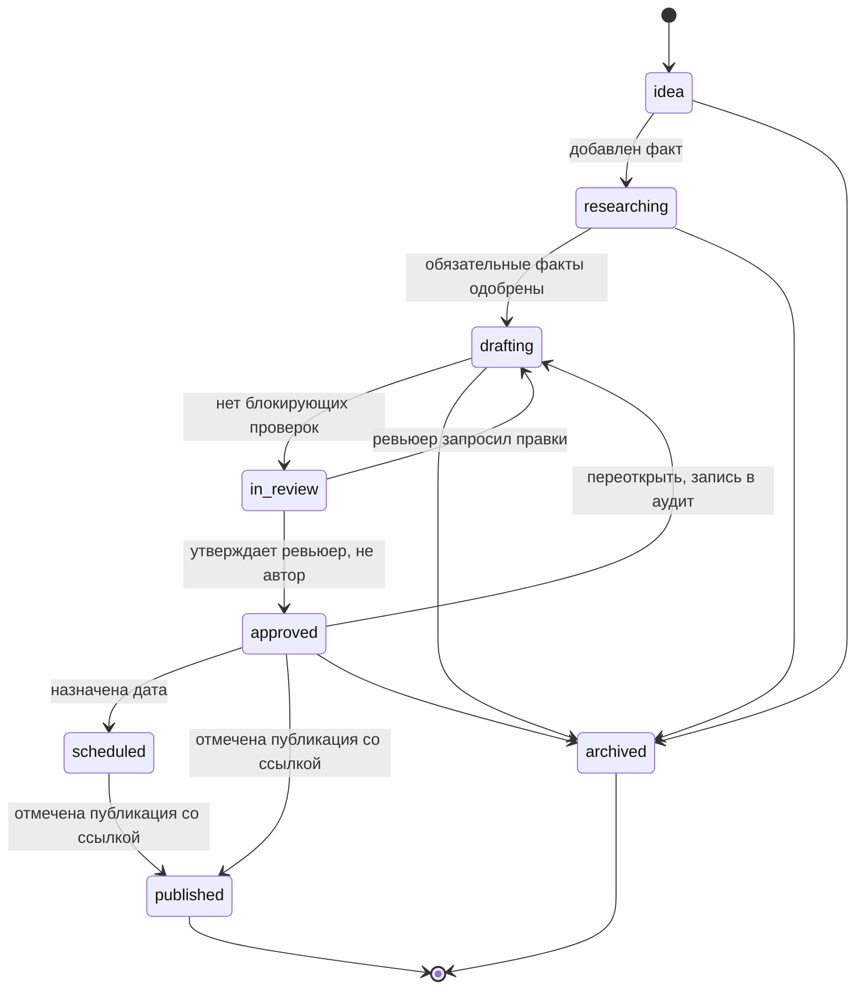
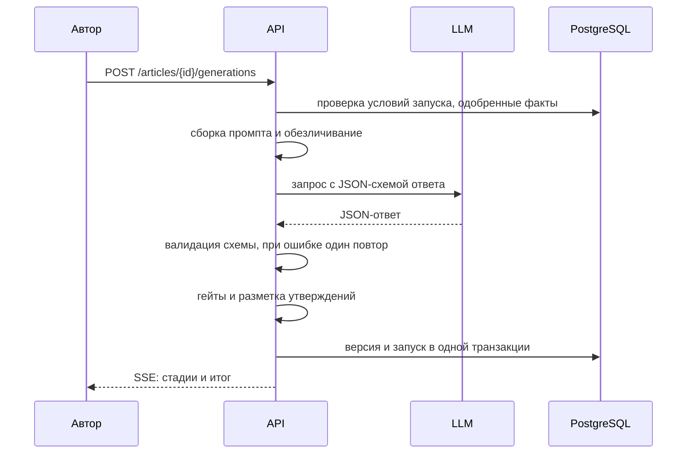
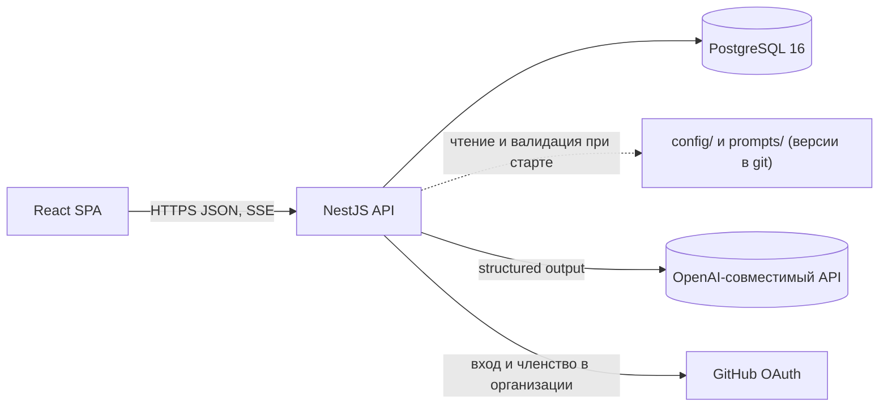

# DzenWriter — видение, дизайн и архитектура

**Статус:** дизайн v0.1 — черновик на согласовании  
**Дата:** 22.10.2026  
**Владелец:** IIRuChating (ответственный назначается при согласовании)  
**Область:** продукт, пайплайн материала, стили и проверки, данные, архитектура, UI, безопасность, план  
**Связанные документы:** [01](01-writing-styles.md), [02](02-data-model.md), [03](03-mvp-backlog.md), [04](04-implementation-status.md), [05](05-ui-brand.md), [06](06-legal-and-safety.md), [ADR](adr/)

> **Важно.** Разработка UI и API начинается после согласования этого документа и открытых вопросов из раздела 18. Стили и промпт уже лежат в репозитории и меняются через PR.

---

## 1. Коротко

DzenWriter — внутренний инструмент IIRuChating для статей в Яндекс Дзен. Он ведёт материал от темы через факт-базу, генерацию и проверки к утверждённой версии. Внутри работает движок Dzen Writer (промпт `prompts/dzen_writer.md`). Публикует человек вручную: инструмент готовит пакет для Дзена и отслеживает результат.

Главная идея: **генерация — не первый шаг, а предпоследний**. Качество держится на фактах и гейтах. Статья без подтверждённых фактов не проходит проверку, как бы хорошо она ни была написана.

| Решение     | Что выбрали                                                     | Почему                                                                                                                               |
| ----------- | --------------------------------------------------------------- | ------------------------------------------------------------------------------------------------------------------------------------ |
| Продукт     | План → факты → генерация → проверки → ревью → экспорт → трекинг | Нужен контроль фактов и повторяемый цикл для регулярных статей                                                                       |
| Стили       | Четыре профиля в YAML, у каждого своя политика фактов           | Требование: личный опыт без выдумок; факты из источников или из одобренной базы                                                      |
| Генерация   | LLM через OpenAI-совместимый адаптер, ответ в JSON по схеме     | Проверяемый результат; смена провайдера без переписывания                                                                            |
| Проверки    | Детерминированные гейты и разметка утверждений                  | Цифры и имена сверяет код, а не внимание редактора                                                                                   |
| Публикация  | Пакет для Дзена и ручная публикация; ссылка вносится в систему  | Официальный способ публикации из API мы не подтвердили. Автоматизация редактора нарушает условия использования и ломается (ADR-0002) |
| Архитектура | Монорепо: React SPA, NestJS API, PostgreSQL, модульный монолит  | Совпадает со стеком iilmchat (ai-ticketbuyer), один деплой, понятная эксплуатация                                                    |
| Доступ      | GitHub OAuth, только участники организации iilmchat             | Своих паролей нет; доступ управляется организацией (ADR-0005)                                                                        |
| Интерфейс   | React, токены Material 3 из ai-brand, Inter и Manrope           | Соответствует бренд-гайду; светлая и тёмная темы из коробки                                                                          |

---

## 2. Цели, не-цели, принципы

### 2.1. Цели v1

- Тематический фокус — ИИ: новости индустрии, агенты и LLM-системы, их внедрение, продукты и опыт IIRuChating. Тема вне фокуса получает предупреждение при создании материала, и запуск подтверждает ревьюер.
- Сократить путь от темы до утверждённой версии. Замеряем медианное время на пилоте (первые 10 материалов), целевое значение задаём по его результатам.
- 100% материалов проходят блокирующие проверки фактов до ревью. Обойти их нельзя: единственный путь — исправить текст или убрать утверждение.
- Один план публикаций и одни статусы для всей команды.
- Настройка стилей и форматов без изменения кода: YAML в git, ревью через PR.
- Воспроизводимость: каждая версия хранит вход, версию стиля, версию промпта, модель и результаты проверок.

### 2.2. Не-цели v1

- Автопубликация в Дзен через скрейпинг, cookies или CSRF-токены редактора.
- Генерация изображений. Формируется только `image_prompt` для внешнего генератора.
- Публикации в другие каналы (VK, Telegram, сайт).
- Редактирование стилей через UI. Запланировано на v2 вместе с версиями в БД.
- Автоматический сбор новостей с сайтов и RSS-лент. Автор добавляет источник вручную.
- Мультиязычность: только русский.

### 2.3. Принципы

1. **Нет факта — нет утверждения.** Гейт, а не совет.
2. **Человек утверждает.** Генерация создаёт черновик. Публикует человек после ревью, и ревьюер не тот, кто писал текст.
3. **Правила — код.** Стили, форматы и промпт версионируются и проходят ревью.
4. **Прозрачность.** Любой фрагмент текста можно проследить до фактов, промпта и модели.
5. **Бренд и доступность.** Токены ai-brand, WCAG 2.2 AA, русская локаль.

---

## 3. Пользователи и сценарии

| Роль          | Кто                                | Что делает                                                                  |
| ------------- | ---------------------------------- | --------------------------------------------------------------------------- |
| Автор         | Контент-менеджер или эксперт       | Ведёт материалы, добавляет факты, запускает генерацию, правит текст         |
| Ревьюер       | Руководитель контента или продукта | Одобряет факты и согласия, утверждает материалы, отмечает публикации        |
| Администратор | Tech lead                          | Роли, лимиты LLM, аудит. Конфигурация стилей меняется через PR, не через UI |

**3.1. Новость индустрии.** Автор добавляет цитату источника, URL и дату публикации (факт `news_source`). Выбирает стиль «Новости индустрии» и формат «Новость». Запускает генерацию и видит, что два числа сверены с фактами, а одно имя — нет. Правит текст, отправляет на ревью. Ревьюер утверждает, пакет экспортируется.

**3.2. Наш опыт и достижения.** Автор собирает два-три факта о команде. Ревьюер одобряет их. Если назван клиент, проверяется разрешение. Стиль «Наш опыт», формат «Кейс». Генерация использует только одобренные факты.

**3.3. Описание продукта.** Продукт выбирается из справочника. Нужно минимум три одобренных факта о продукте, среди них ограничения. Стиль «Описание продукта». Гейт требует маркировку рекламы до утверждения.

**3.4. Личный опыт.** Автор заносит заметки (интервью или записи) и подтверждает согласие. Инструмент помогает обезличить текст: имена заменяются ролями, автор проверяет результат. Генерация идёт от первого лица. Если заметок мало, модель возвращает вопросы автору, а не дописывает историю.

**3.5. Трекинг.** После публикации автор вносит ссылку на статью в Дзене. В v2 добавляются метрики (просмотры, прочтения, время чтения) вручную или импортом CSV.

---

## 4. Модули продукта

| Модуль          | Ответственность                                                     | Версия       |
| --------------- | ------------------------------------------------------------------- | ------------ |
| Планирование    | Доска статусов, фильтры, плановые даты                              | v1           |
| Материалы       | Тема, стиль, формат, тон, объём, владелец, история статусов         | v1           |
| Факт-база       | Библиотека фактов, одобрение, согласия, источники                   | v1           |
| Продукты        | Справочник продуктов, о которых пишем                               | v1           |
| Стили и форматы | Загрузка и валидация YAML, карточки в UI (только чтение)            | v1           |
| Генерация       | Сборка промпта, вызов LLM, разбор JSON, повтор при ошибке           | v1           |
| Проверки        | Гейты фактов, структурные и стилевые проверки, разметка утверждений | v1           |
| Редактор        | Markdown-редактор, предпросмотр в духе Дзена, версии, сравнение     | v1           |
| Ревью           | Утверждение, запрос правок, решения с комментарием                  | v1           |
| Экспорт         | Пакет для Дзена: текст, метаданные, промпт обложки, чек-лист        | v1           |
| Публикации      | Статусы, плановые даты, ссылки на статьи                            | v1           |
| Метрики         | Ручной ввод и импорт CSV, сравнение материалов                      | v2           |
| Аудит           | Журнал действий                                                     | v1 (базовый) |
| Пользователи    | Роли, отключение, сессии                                            | v1           |

---

## 5. Жизненный цикл материала



| Переход                                            | Условие                                                                           | Кто               |
| -------------------------------------------------- | --------------------------------------------------------------------------------- | ----------------- |
| `idea → researching`                               | Добавлен первый факт или выбран вручную                                           | Автор             |
| `researching → drafting`                           | Для стиля выполнено `inputs`: нужные типы фактов в нужном количестве и одобрены   | Автор             |
| `drafting → in_review`                             | Последняя версия без блокирующих проверок; для рекламного текста стоит маркировка | Автор             |
| `in_review → drafting`                             | Ревьюер запросил правки, комментарий обязателен                                   | Ревьюер           |
| `in_review → approved`                             | Ревьюер не совпадает с автором; версия фиксируется                                | Ревьюер           |
| `approved → drafting`                              | Переоткрытие для правок, запись в аудит                                           | Автор или админ   |
| `approved / scheduled → published`                 | Указан URL публикации в Дзене                                                     | Автор или ревьюер |
| `idea, researching, drafting, approved → archived` | Снятие с плана                                                                    | Автор или админ   |

Блокирующие проверки фактов нельзя пропустить. Предупреждения можно подтвердить с комментарием, и это попадает в аудит.

---

## 6. Стили и политика фактов

Четыре стиля, подробности — в [01-writing-styles.md](01-writing-styles.md).

| Стиль                                          | Голос                                       | Политика фактов                                            | Нужно на входе                                                |
| ---------------------------------------------- | ------------------------------------------- | ---------------------------------------------------------- | ------------------------------------------------------------- |
| `industry-news` — Новости индустрии            | Третье лицо, аналитический, технический     | `sourced`: каждое число, имя и дата со ссылкой на источник | Минимум один источник с датой                                 |
| `company-achievements` — Наш опыт и достижения | «Мы», описательный                          | `approved_only`: только одобренные факты компании          | Минимум два одобренных факта; разрешение на названия клиентов |
| `product-description` — Описание продукта      | «Вы», дружелюбный, описательный             | `approved_only`: только одобренные факты продукта          | Продукт и минимум три одобренных факта, среди них ограничения |
| `personal-experience` — Личный опыт            | «Я», разговорный, от пользователя ИИ-систем | `experience_only`: только заметки опыта с согласием        | Заметки от 800 знаков, согласие, обезличивание                |

Формат (новость, статья, лонгрид, подборка, кейс) задаёт каркас и объём. Он настраивается отдельно в `config/formats.yaml`. Стиль задаёт голос и политику фактов. Поэтому «новость» может быть в стиле «Новости индустрии», а «кейс» — в стиле «Наш опыт».

---

## 7. Генерация и проверки

### 7.1. Сборка промпта и обращение к модели

Промпт собирается слоями, каждый слой версионируется:

1. Базовый промпт `prompts/dzen_writer.md`: роль, правила фактов, структура, качество, формат ответа.
2. Инструкции стиля из `config/styles/<id>.yaml`.
3. Каркас формата из `config/formats.yaml`.
4. Одобренные факты с метками `F1…Fn`: тип, текст, источник, дата.
5. Задача: тема, ключевые слова, тон, объём, продукт, сегодняшняя дата.

Факты передаются как данные, а не как инструкции. Приложение не загружает страницы по ссылкам: автор вставляет текст цитаты и URL сам. Так снижается риск prompt injection через веб-страницы и SSRF.

Персональные данные из заметок опыта обезличиваются до сборки промпта (см. [06-legal-and-safety.md](06-legal-and-safety.md)).



### 7.2. Контракт вывода

Модель возвращает JSON по схеме (structured output):

```json
{
  "status": "ok | needs_input",
  "title": "до 80 знаков",
  "article_markdown": "тело статьи без H1",
  "seo_title": "до 70 знаков",
  "tags": ["5–7 строк"],
  "description": "1–2 предложения",
  "image_prompt": "1–2 предложения на русском",
  "claims": [{ "text": "…", "type": "fact | hypothesis | opinion", "fact_ids": ["F1"] }],
  "questions": ["только при status = needs_input"],
  "advertising_label_suggested": false,
  "disclaimer_needed": false
}
```

Публичный текст собирается кодом: `# {title}`, тело статьи, разделитель `---`, строки `SEO_TITLE`, `TAGS`, `DESCRIPTION`, `IMAGE_PROMPT`. Это тот же формат, что в исходной спецификации Dzen Writer, поэтому выход для читателя не меняется.

Если JSON не проходит валидацию, выполняется один повтор с текстом ошибки. Если и он не помог, запуск получает статус `failed`, текущая версия не меняется.

### 7.3. Гейты

Проверки запускаются при каждой генерации и каждом сохранении версии. Блокирующие ошибки запрещают переход в `in_review`.

| Проверка                       | Уровень        | Стили       | Как работает                                                                                     |
| ------------------------------ | -------------- | ----------- | ------------------------------------------------------------------------------------------------ |
| `numbers_must_map_to_facts`    | block          | все         | Каждое число, процент, сумма и дата в тексте есть в указанных фактах                             |
| `names_must_map_to_facts`      | block          | все         | Имена, продукты и организации есть в фактах или в теме (эвристика, возможны ложные срабатывания) |
| `claims_need_fact_ids`         | block          | все         | Утверждения типа `fact` имеют `fact_ids`, и такие ID существуют                                  |
| `superlatives_need_fact`       | block или warn | по стилю    | «лучший», «самый», «№1», «уникальный» без подтверждающего факта                                  |
| `guarantees_forbidden`         | block          | по стилю    | «гарантируем», «100%», «без риска»                                                               |
| `first_person_expected`        | block          | личный опыт | В тексте есть первое лицо единственного числа                                                    |
| `personal_names_forbidden`     | block          | личный опыт | Имена людей и компаний не названы без разрешения                                                 |
| `client_names_need_permission` | block          | наш опыт    | Клиенты названы только при `client_permission`                                                   |
| `ad_disclosure_required`       | block или warn | по стилю    | Текст о продукте без маркировки рекламы                                                          |
| `limitations_section_required` | warn           | продукт     | В тексте о продукте нет раздела об ограничениях                                                  |
| `source_date_required`         | block          | новости     | У источника нет даты публикации                                                                  |
| `disclaimer_required`          | block          | по теме     | Тема медицинская, юридическая или финансовая, а дисклеймера нет                                  |
| `title_length`                 | block          | все         | Заголовок длиннее 80 знаков                                                                      |
| `seo_title_length`             | block          | все         | SEO-заголовок длиннее 70 знаков                                                                  |
| `tags_count`                   | block          | все         | Тегов не 5–7                                                                                     |
| `length_in_range`              | warn           | все         | Объём вне диапазона формата                                                                      |
| `banned_phrases`               | warn           | все         | Штампы из списка промпта                                                                         |
| `clickbait_phrases`            | warn           | все         | «шок», «срочно», «вы не поверите»                                                                |
| `hook_every_3_paragraphs`      | info           | все         | Нет крючка за три абзаца                                                                         |
| `paragraph_length`             | info           | все         | Абзац длиннее четырёх предложений                                                                |

Числа сверяются после нормализации: пробелы в разрядах, запятая и точка, знаки процента и валюты, даты в разных написаниях.

### 7.4. Оценка качества

- **Golden set:** 20 брифов, по пять на каждый стиль, с ожидаемыми фактами и запретами.
- **Автоматические метрики** по каждому прогону: доля версий без блокирующих проверок, доля `needs_input`, соответствие объёму и заголовку.
- **Ручная оценка** редактором по рубрике из пяти критериев: точность, стиль, читаемость, крючки, штампы.
- **Запуск:** вручную и при изменении `prompts/` или `config/styles/`. В CI используется mock LLM. Реальный прогон — с лимитом бюджета.
- Изменение промпта или стиля без результатов golden set в PR не принимается.

---

## 8. Архитектура

### 8.1. Контейнеры



### 8.2. Модули API (модульный монолит)

| Модуль         | Отвечает за                            |
| -------------- | -------------------------------------- |
| `auth`         | GitHub OAuth, сессии, роли             |
| `articles`     | Материалы, статусы, версии             |
| `facts`        | Факт-база, одобрение, согласия         |
| `products`     | Справочник продуктов                   |
| `config`       | Загрузка и валидация стилей и форматов |
| `generation`   | Сборка промпта, вызов LLM, SSE, повтор |
| `checks`       | Гейты, разметка утверждений            |
| `reviews`      | Ревью и решения                        |
| `publications` | Экспорт пакета, статусы публикаций     |
| `audit`        | Журнал действий                        |
| `health`       | `/health`, `/ready`                    |

Границы модулей соблюдаем через сервисы и интерфейсы. Модуль `generation` зависит от интерфейса `LlmProvider`, а не от конкретного провайдера. Если понадобятся отдельные воркеры, модуль выносится без переписывания домена.

### 8.3. Фронтенд

- React 19, TypeScript, Vite, React Router.
- Серверное состояние: TanStack Query. Локальное состояние UI: React state, Zustand только при необходимости.
- Формы: React Hook Form и Zod-схемы из `packages/shared`. Одна схема для API и UI.
- Редактор: CodeMirror 6. Предпросмотр: react-markdown, remark-gfm и rehype-sanitize. Сырой HTML из ответа модели не выполняется.
- Стили: Tailwind CSS. Цвета через CSS-переменные `--md-sys-color-*` из `design/brand/theme-m3.css`.
- Доска: dnd-kit с перетаскиванием с клавиатуры. Переход статуса всё равно проходит через API и гейты.
- Структура: `src/features/<модуль>/` с компонентами, хуками и API-клиентом; общие элементы интерфейса в `src/shared/ui/`.

### 8.4. Структура репозитория

```text
apps/
  web/                React SPA
  api/                NestJS API
packages/
  shared/             Zod-схемы, типы, константы статусов
  db/                 Drizzle-схема, миграции, seed
config/               форматы и стили (YAML, валидируются при старте)
prompts/              базовый промпт Dzen Writer
design/brand/         ассеты ai-brand
docs/                 документация и ADR
prototype/            HTML-прототип
```

### 8.5. Интеграции

- **GitHub OAuth:** вход и проверка членства в организации `iilmchat` (scope `read:org`). Подробнее — ADR-0005.
- **LLM:** адаптер `LlmProvider` с методами `generate(schema, messages)` и `stream(...)`. Первая реализация — OpenAI-совместимый API (`LLM_BASE_URL`, `LLM_API_KEY`, `LLM_MODEL`), как в ai-ticketbuyer. Второй провайдер добавляется реализацией интерфейса.
- **Дзен:** только экспорт пакета и ручная отметка публикации. Импорт статистики (CSV) — v2.

### 8.6. Надёжность

- Генерация идёт через SSE. Клиент показывает стадии: сбор промпта, генерация, разбор, проверки. Если соединение оборвалось, сервер доводит запуск до конца и сохраняет результат в `generation_runs`. Его можно открыть из истории материала.
- Таймаут LLM задаётся переменной окружения. Автор может отменить запуск.
- Версии защищены оптимистичной блокировкой (`articles.version`): две одновременные правки не перезаписывают друг друга.
- Повторные отправки генерации и отметки публикации защищены ключом идемпотентности.
- Миграции — отдельный одноразовый сервис `migrate` в compose и отдельный шаг CI. API не мигрирует при старте, поэтому реплики не конкурируют за схему. Это отличие от ai-ticketbuyer.
- Очередь заданий (BullMQ и Redis) в v1 не нужна. Генерация идёт синхронно через SSE. Очередь понадобится для пакетной генерации плана на неделю (v2). Так же, как в ai-ticketbuyer, где BullMQ — следующий этап.

---

## 9. Данные

Полная схема — в [02-data-model.md](02-data-model.md). Основные сущности: `users`, `sessions`, `products`, `articles`, `facts`, `article_facts`, `article_versions`, `generation_runs`, `reviews`, `publications`, `metric_snapshots` (v2), `audit_log`.

Ключевые правила:

- Факт — общая библиотека. Один факт может использоваться в нескольких материалах. Метка `F1…Fn` задаётся на материал.
- Одобренный факт не редактируется. Исправление создаёт новый факт, старый получает статус `superseded`.
- Версия статьи неизменяема. Правка создаёт новую версию.
- `generation_runs.input_snapshot` хранит входы без персональных данных: ID фактов, параметры, хеш собранного промпта. Срок хранения — 180 дней (предложение).
- Отзыв согласия на опыт удаляет текст заметки. В аудите остаются идентификатор и дата.

---

## 10. API v1

Префикс `/api/v1`. Ошибки — в формате RFC 9457 (`application/problem+json`). Для операций, которые создают запуски или публикации, нужен заголовок `Idempotency-Key`.

| Метод и путь                                                        | Назначение                                                                          | Роль                                             |
| ------------------------------------------------------------------- | ----------------------------------------------------------------------------------- | ------------------------------------------------ |
| `GET /auth/github/start`, `GET /auth/github/callback`               | Вход через GitHub                                                                   | —                                                |
| `POST /auth/logout`, `GET /me`                                      | Выход, текущий пользователь                                                         | любая                                            |
| `GET /styles`, `GET /formats`                                       | Стили и форматы (только чтение)                                                     | любая                                            |
| `GET /articles`, `POST /articles`                                   | Список и создание материала                                                         | author                                           |
| `GET /articles/{id}`, `PATCH /articles/{id}`                        | Карточка и метаданные (тема, стиль, формат)                                         | author                                           |
| `POST /articles/{id}/transitions`                                   | Смена статуса с гейтами                                                             | по правилам раздела 5                            |
| `POST /articles/{id}/facts`, `DELETE /articles/{id}/facts/{factId}` | Привязка и отвязка фактов, метки F<n>; факты материала приходят в карточке          | владелец, до утверждения                         |
| `POST /articles/{id}/generation-confirmation`                       | Подтверждение ревьюера на запуск генерации для темы вне фокуса ИИ                   | ревьюер, не автор                                |
| `POST /articles/{id}/generations`                                   | Запуск генерации, SSE со стадиями. `Idempotency-Key` защищает от повторного запуска | владелец                                         |
| `GET /articles/{id}/generations`                                    | История запусков материала                                                          | любой вошедший                                   |
| `POST /articles/{id}/generations/{runId}/cancel`                    | Отмена запуска                                                                      | автор запуска или администратор                  |
| `GET /facts`, `POST /facts`, `PATCH /facts/{id}`                    | Библиотека и правка черновика                                                       | любой вошедший; правка — автор или администратор |
| `POST /facts/{id}/approve`, `POST /facts/{id}/reject`               | Одобрение и отклонение                                                              | ревьюер, не автор факта                          |
| `POST /facts/{id}/consent`, `POST /facts/{id}/consent/withdraw`     | Согласие на личный опыт и отзыв (текст удаляется)                                   | ревьюер; отзыв также автор заметки               |
| `POST /facts/{id}/corrections`                                      | Исправление одобренного факта                                                       | любой вошедший                                   |
| `GET /articles/{id}/versions`, `GET /articles/{id}/versions/{n}`    | История версий                                                                      | author                                           |
| `POST /articles/{id}/versions`                                      | Ручное сохранение версии с проверками                                               | author                                           |
| `POST /articles/{id}/reviews`                                       | Утвердить или запросить правки                                                      | reviewer                                         |
| `GET /articles/{id}/export`                                         | Пакет для Дзена (zip)                                                               | author                                           |
| `POST /articles/{id}/publication`                                   | Запланировать или отметить публикацию со ссылкой                                    | author, reviewer                                 |
| `GET /products`, `POST /products`, `PATCH /products/{id}`           | Справочник продуктов (архивирование без удаления)                                   | чтение — все, запись — администратор             |
| `GET /audit`                                                        | Журнал действий                                                                     | admin                                            |
| `GET /users`, `PATCH /users/{id}`                                   | Список, роль и отключение (отзывает сессии)                                         | admin                                            |

---

## 11. UI и брендинг

Подробно — в [05-ui-brand.md](05-ui-brand.md). Коротко:

- Базовые цвета из `theme-m3.css` (Material 3, схема Fidelity, seed `#8B5CF6` и `#0EA5E9`). Компоненты используют роли, а не HEX.
- Шрифты: Inter для интерфейса и текста, Manrope для заголовков страниц. Montserrat в приложении не используется.
- Логотип: иконка IIRuChating в шапке, полный логотип на странице входа. В тёмной теме — белая версия иконки.
- По умолчанию — системная тема, переключатель в шапке.
- Главный экран — доска статусов. Главный рабочий экран — редактор с панелью проверок. Статус всегда продублирован текстом, а не только цветом.

---

## 12. Безопасность и право

Подробно — в [06-legal-and-safety.md](06-legal-and-safety.md). Ключевое:

- Доступ только для участников организации. Роли в приложении. Аудит изменений.
- Секреты только в переменных окружения. Ключи LLM не попадают в браузер.
- Ответ модели — недоверенный ввод. Рендер санитизируется, ссылки открываются с `rel="noopener noreferrer"`.
- Персональные данные из опыта: согласие, обезличивание, право на отзыв.
- Реклама: материалы о собственных продуктах требуют маркировки. Решение принимает ответственный, по согласованию с юристом.
- Перед запуском проверяются условия провайдера LLM: обработка данных и отсутствие обучения на наших данных.

---

## 13. Наблюдаемость и эксплуатация

- Логи в формате JSON (pino), `requestId` в каждом запросе. Тексты статей, факты и промпты в обычные логи не пишутся.
- Метрики: латентность и токены генерации, стоимость на материал, доля запусков `needs_input` и `failed`, доля блокирующих проверок по стилям. Последние две помогают настраивать промпты.
- Бюджет: лимит генераций на пользователя в день и общий лимит стоимости (переменные окружения).
- Health: `/health` проверяет процесс, `/ready` — БД и загруженный конфиг.
- Резервные копии PostgreSQL ежедневно, хранение 14 дней (предложение). Восстановление проверяется раз в месяц.
- Dependabot и `pnpm audit` в CI.

---

## 14. Тестирование

| Уровень        | Что проверяем                                                                                  | Инструмент                   |
| -------------- | ---------------------------------------------------------------------------------------------- | ---------------------------- |
| Unit           | Гейты, переходы статусов, сборка промпта, нормализация чисел, валидация YAML                   | Vitest                       |
| Снимки промпта | Случайные изменения промпта видны в диффе                                                      | Vitest snapshot              |
| Интеграция API | Роли, переходы, гейты, идемпотентность                                                         | Vitest и PostgreSQL в Docker |
| E2E            | Сценарий «тема → факты → генерация (mock LLM) → проверки → ревью → экспорт», доступность (axe) | Playwright                   |
| Оценка LLM     | Golden set, см. раздел 7.4                                                                     | Скрипт, запуск вручную       |

Mock LLM в CI возвращает фиксированные JSON-ответы. Реальные вызовы в CI запрещены.

---

## 15. Инженерные практики

- pnpm 12, Node 24, строгий TypeScript, ESLint, Prettier. Версии как в ai-ticketbuyer.
- Conventional Commits. Шаблон PR с чек-листами «факты и гейты», «персональные данные», «реклама».
- Защита `main`: PR, один ревьюер, зелёный CI, без прямых пушей.
- Документация и ADR обновляются в том же PR, что и код.
- Изменения в `config/styles/`, `config/formats.yaml` и `prompts/` требуют ревью руководителя контента. CODEOWNERS закрепит это после создания команды в организации.
- Секреты только в переменных окружения. В репозитории — `.env.example` без значений.

---

## 16. План поставки

| Этап    | Содержание                                       | Результат                             |
| ------- | ------------------------------------------------ | ------------------------------------- |
| M0      | Согласование этого документа и открытых вопросов | Согласованный дизайн v1.0             |
| M1      | E1 Foundations, E2 Auth и роли                   | Запуск локально, вход через GitHub    |
| M2      | E3 Материалы и доска, E4 Факт-база, E5 Стили     | Доска, факты, карточки стилей         |
| M3      | E6 Генерация, E7 Проверки, E8 Редактор           | Генерация с гейтами, редактор, версии |
| M4      | E9 Ревью и экспорт, E11 Право и эксплуатация     | Пилот на 10 материалах                |
| M5 (v2) | E10 Метрики, редактор стилей в UI, очередь       | Решение по итогам пилота              |

Оценка для M1–M4: 6–8 недель для двух разработчиков, включая отладку промптов. Оценка предварительная и уточняется после M0.

---

## 17. Риски

| Риск                                      | Вероятность | Влияние | Меры                                                                               |
| ----------------------------------------- | ----------- | ------- | ---------------------------------------------------------------------------------- |
| Модель выдумывает факты и цифры           | Высокая     | Высокое | Факты с метками, разметка утверждений, гейты, golden set                           |
| Выдуманный личный опыт                    | Средняя     | Высокое | Режим `experience_only`, `needs_input`, согласие, проверка ревьюером               |
| Изменение правил Дзена или маркировки     | Средняя     | Среднее | Ручная публикация, чек-лист перед публикацией, пересмотр документов раз в квартал  |
| Персональные данные уходят провайдеру LLM | Средняя     | Высокое | Обезличивание, минимизация входа, соглашение об обработке данных, выбор провайдера |
| Штампы и однотипный текст                 | Высокая     | Среднее | Список штампов, оценка редактором, правки стиля через PR                           |
| Зависимость от одного провайдера          | Средняя     | Среднее | Адаптер `LlmProvider`, второй провайдер в конфиге                                  |
| Рост стоимости генерации                  | Средняя     | Низкое  | Лимиты, выбор модели по формату, история версий без повторных запросов             |
| Ложные срабатывания проверки имён         | Высокая     | Низкое  | Кнопка «ложное срабатывание» с записью в аудит, подстройка эвристики               |

---

## 18. Открытые вопросы

Нужны решения до M1.

1. **Хостинг.** Внутренний сервер или облако; где БД и резервные копии.
2. **Провайдер LLM.** Какой и на каких условиях обработки данных; обязателен ли отказ от обучения на наших данных.
3. **Роли.** Кто ревьюер материалов, кто одобряет факты и согласия.
4. **Реклама.** Как маркировать материалы о собственных продуктах; нужна консультация юриста по ФЗ «О рекламе».
5. **Маркировка ИИ-контента.** Нужна ли публичная пометка «создано с помощью ИИ» и что требуют правила Дзена на дату публикации.
6. **Объём.** Подтвердить длины для лонгрида, подборки и кейса (сейчас предложение).
7. **Статистика Дзена.** Откуда берём метрики и в каком виде (ручной ввод или CSV).
8. **Название репозитория.** Предложено `ai-dzenwriter` по аналогии с `ai-ticketbuyer`.

---

## 19. Решения по умолчанию

Приняты без явного согласования. Если что-то не подходит, меняем до M1.

| Тема               | Решение по умолчанию                                     | Почему                                                 |
| ------------------ | -------------------------------------------------------- | ------------------------------------------------------ |
| `image_prompt`     | Формируется всегда                                       | Обложка нужна для Дзена; промпт дешевле, чем переделка |
| Формат и стиль     | Формат задаёт каркас и объём, стиль задаёт голос и факты | Разделяет оси «новость» и «кейс» в одной схеме         |
| Вывод модели       | JSON по схеме, публичный текст собирает код              | Надёжный разбор и разметка утверждений                 |
| Хранение стилей    | YAML в git                                               | Ревью, история, откат                                  |
| Публикация         | Ручная, со ссылкой                                       | ADR-0002                                               |
| Вход в систему     | GitHub OAuth, организация iilmchat                       | ADR-0005                                               |
| Фактические данные | Ручной ввод и вставка цитат, без загрузки страниц        | Снижает риск prompt injection и SSRF                   |

---

## 20. Архитектурные решения (ADR)

| ADR                                                  | Тема                                   | Статус     |
| ---------------------------------------------------- | -------------------------------------- | ---------- |
| [0001](adr/0001-stack-and-monorepo.md)               | Стек и монорепозиторий                 | Предложено |
| [0002](adr/0002-dzen-publishing-manual.md)           | Публикация в Дзен вручную              | Предложено |
| [0003](adr/0003-styles-as-config.md)                 | Стили как конфигурация в git           | Предложено |
| [0004](adr/0004-structured-output-and-fact-gates.md) | Структурированный вывод и гейты фактов | Предложено |
| [0005](adr/0005-github-oauth-org-access.md)          | Доступ через GitHub OAuth              | Предложено |

Новые решения оформляются ADR в `docs/adr/` по шаблону: контекст, решение, альтернативы, последствия.

---

## Приложение А. Глоссарий

| Термин              | Значение                                                                       |
| ------------------- | ------------------------------------------------------------------------------ |
| Материал            | Статья в работе: тема, стиль, формат, версии, факты и публикация               |
| Стиль               | Конфигурация голоса, политики фактов, проверок и инструкций для модели         |
| Формат              | Каркас, объём и число блоков: новость, статья, лонгрид, подборка, кейс         |
| Факт                | Единица базы: цитата источника, факт компании, факт продукта или заметка опыта |
| Факт-база           | Общая библиотека фактов                                                        |
| Метка `F1…Fn`       | Короткий идентификатор факта внутри материала, который видит модель            |
| Гейт                | Блокирующая проверка: материал нельзя перевести в ревью, пока она не пройдена  |
| Утверждение (claim) | Фрагмент текста, размеченный типом и ссылками на факты                         |
| Заметка опыта       | Записанный опыт реального человека с согласием и обезличиванием                |
| Пакет для Дзена     | Файлы для ручной публикации: текст, метаданные, промпт обложки, чек-лист       |
| Golden set          | Набор эталонных брифов для оценки качества промптов и стилей                   |
| `needs_input`       | Статус ответа модели: фактов не хватает, нужны ответы автора                   |
