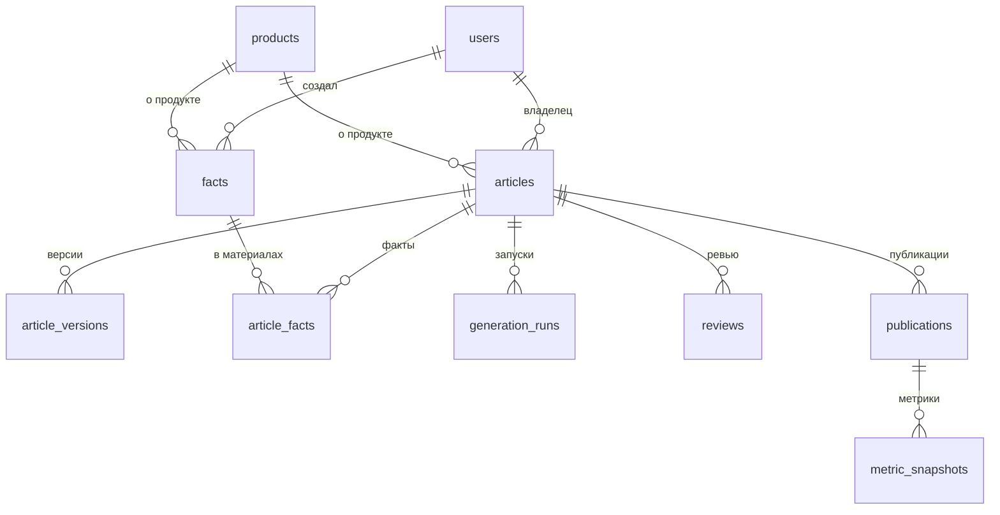

# Модель данных

**Статус:** черновик v0.1  
**Дата:** 22.10.2026  
**СУБД:** PostgreSQL 16, Drizzle ORM  
**Связанные документы:** [00-design](00-design.md), [01-writing-styles](01-writing-styles.md)

**Соглашения.** `id` — UUID v4. По умолчанию значение выдаёт сама БД (`gen_random_uuid()`, миграция 0002), приложение может передать свой. Время — `timestamptz` в UTC; в интерфейсе показываем по Europe/Moscow. Статусы и типы — `text` с ограничением CHECK, а не нативные enum: так миграции проще. Все таблицы содержат `created_at`, если не указано иное.

## 1. Перечисления

| Перечисление         | Значения                                                                                         |
| -------------------- | ------------------------------------------------------------------------------------------------ |
| `article_status`     | `idea`, `researching`, `drafting`, `in_review`, `approved`, `scheduled`, `published`, `archived` |
| `article_format`     | `news`, `article`, `longread`, `roundup`, `case`                                                 |
| `tone`               | `neutral`, `expert-conversational`, `engaging`                                                   |
| `fact_type`          | `news_source`, `company_fact`, `product_fact`, `experience_note`                                 |
| `fact_status`        | `draft`, `approved`, `rejected`, `superseded`                                                    |
| `user_role`          | `author`, `reviewer`, `admin`                                                                    |
| `generation_status`  | `running`, `succeeded`, `needs_input`, `failed`, `cancelled`                                     |
| `review_decision`    | `approved`, `changes_requested`                                                                  |
| `publication_status` | `scheduled`, `published`                                                                         |
| `check_severity`     | `block`, `warn`, `info`                                                                          |

## 2. Таблицы

### users

| Поле          | Тип               | Примечание                                             |
| ------------- | ----------------- | ------------------------------------------------------ |
| `id`          | uuid, PK          |                                                        |
| `github_id`   | bigint, unique    | Стабильный идентификатор GitHub                        |
| `login`       | text, unique      |                                                        |
| `name`        | text, null        |                                                        |
| `role`        | user_role         | По умолчанию `author`                                  |
| `disabled_at` | timestamptz, null | Заблокированный пользователь не входит и теряет сессии |

### sessions

| Поле         | Тип               | Примечание                               |
| ------------ | ----------------- | ---------------------------------------- |
| `id`         | uuid, PK          |                                          |
| `user_id`    | uuid, FK на users |                                          |
| `token_hash` | text, unique      | SHA-256 от токена; сам токен не хранится |
| `expires_at` | timestamptz       | TTL 30 дней, как в ai-ticketbuyer        |
| `revoked_at` | timestamptz, null |                                          |

### products

| Поле                | Тип               | Примечание               |
| ------------------- | ----------------- | ------------------------ |
| `id`                | uuid, PK          |                          |
| `slug`              | text, unique      |                          |
| `name`, `one_liner` | text              |                          |
| `archived_at`       | timestamptz, null | Архивируем, а не удаляем |

### articles

| Поле                        | Тип                        | Примечание                                 |
| --------------------------- | -------------------------- | ------------------------------------------ |
| `id`                        | uuid, PK                   |                                            |
| `topic`                     | text                       | Тема или инфоповод                         |
| `keywords`                  | text[]                     | Ключевые слова                             |
| `title`                     | text, null                 | Рабочий заголовок                          |
| `style_id`                  | text                       | Идентификатор стиля из `config/styles`     |
| `format`                    | article_format             |                                            |
| `tone`                      | tone                       |                                            |
| `length_min`, `length_max`  | int                        | Берутся из формата или переопределяются    |
| `product_id`                | uuid, FK на products, null | Обязателен для стиля `product-description` |
| `status`                    | article_status             |                                            |
| `owner_id`                  | uuid, FK на users          | Автор                                      |
| `reviewer_id`               | uuid, FK на users, null    | Назначенный ревьюер                        |
| `current_version_number`    | int, null                  | Номер текущей версии                       |
| `planned_at`                | timestamptz, null          | Плановая дата публикации                   |
| `version`                   | int                        | Оптимистичная блокировка                   |
| `updated_at`, `archived_at` | timestamptz                |                                            |

Индексы: `(status, planned_at)`, `(owner_id, status)`.

### facts

| Поле                                           | Тип                        | Примечание                                                                   |
| ---------------------------------------------- | -------------------------- | ---------------------------------------------------------------------------- |
| `id`                                           | uuid, PK                   |                                                                              |
| `type`                                         | fact_type                  |                                                                              |
| `text`                                         | text                       | Текст факта или обезличенная заметка опыта                                   |
| `source_name`                                  | text, null                 | Издание, документ или «внутренние данные»                                    |
| `source_url`                                   | text, null                 | Обязателен для `news_source`                                                 |
| `source_published_at`                          | date, null                 | Обязательна для `news_source`                                                |
| `product_id`                                   | uuid, FK на products, null | Обязателен для `product_fact`                                                |
| `status`                                       | fact_status                |                                                                              |
| `mentions_client`                              | boolean                    | Текст содержит название клиента                                              |
| `client_permission`                            | boolean                    | Разрешение на название клиента получено                                      |
| `consent_confirmed`                            | boolean                    | Для `experience_note`: согласие подтверждено                                 |
| `consent_confirmed_by`, `consent_confirmed_at` | uuid, timestamptz, null    | Кто и когда подтвердил согласие                                              |
| `anonymized`                                   | boolean                    | Имена заменены ролями                                                        |
| `created_by`, `approved_by`                    | uuid, FK на users          |                                                                              |
| `approved_at`                                  | timestamptz, null          |                                                                              |
| `superseded_by`                                | uuid, FK на facts, null    | Заменяющий факт                                                              |
| `supersedes_id`                                | uuid, FK на facts, null    | Исправляемый факт: исправление ссылается на одобренный факт, который заменит |
| `version`                                      | int                        | Оптимистичная блокировка, +1 при каждом изменении                            |

Ограничения, проверяются в CHECK и в сервисе:

- `approved` для `news_source` требует `source_url` и `source_published_at`;
- `approved` для `experience_note` требует `consent_confirmed` и `anonymized`;
- `approved` для `product_fact` требует `product_id`;
- одобренный факт не редактируется: исправление создаёт новый факт, старый переводится в `superseded`;
- `supersedes_id` не равен `id` (CHECK `facts_supersedes_self_check`);
- исправление переводит исходный факт в `superseded` в момент одобрения исправления, а не при его создании: до этого исходный факт продолжает работать. На один факт — одно исправление на проверке.

Исключение из неизменяемости — отзыв согласия на заметку опыта: текст очищается, отметки сбрасываются, статус становится `rejected` (или остаётся `superseded`). В аудите остаются ID и дата.

### article_facts

| Поле                   | Тип                  | Примечание                                                                                                                                                     |
| ---------------------- | -------------------- | -------------------------------------------------------------------------------------------------------------------------------------------------------------- |
| `article_id`           | uuid, FK на articles | PK вместе с `fact_id`                                                                                                                                          |
| `fact_id`              | uuid, FK на facts    |                                                                                                                                                                |
| `label`                | text                 | `F1`, `F2` и так далее; уникален внутри материала; номер не повторяется: берётся наибольший из текущих связей и записей `article.fact_attach` в журнале аудита |
| `added_by`, `added_at` |                      |                                                                                                                                                                |

### article_versions

| Поле                | Тип                               | Примечание                                                                      |
| ------------------- | --------------------------------- | ------------------------------------------------------------------------------- |
| `id`                | uuid, PK                          |                                                                                 |
| `article_id`        | uuid, FK на articles              | Уникально вместе с `number`                                                     |
| `number`            | int                               | 1, 2, 3…                                                                        |
| `origin`            | text                              | `generated`, `manual` или `rollback`                                            |
| `title`             | text                              |                                                                                 |
| `article_markdown`  | text                              | Тело статьи без H1                                                              |
| `seo_title`         | text                              |                                                                                 |
| `tags`              | text[]                            |                                                                                 |
| `description`       | text                              |                                                                                 |
| `image_prompt`      | text                              |                                                                                 |
| `advertising_label` | boolean                           | Маркировка рекламы поставлена                                                   |
| `disclaimer_text`   | text, null                        |                                                                                 |
| `claims`            | jsonb                             | Утверждения: текст, тип, `factIds` и смещение в `article_markdown`              |
| `checks`            | jsonb                             | Результаты проверок: идентификатор, уровень, позиция, сообщение, решение автора |
| `style_version`     | int                               | Версия стиля на момент генерации                                                |
| `prompt_version`    | text                              | Версия промпта и конфигурации, git SHA                                          |
| `generation_run_id` | uuid, FK на generation_runs, null |                                                                                 |
| `created_by`        | uuid, FK на users                 |                                                                                 |

Версия неизменяема: триггер `article_versions_append_only` (миграция 0001) запрещает UPDATE и DELETE.

Решение автора по проверке хранится в самой проверке: `decision`, `comment`, `confirmedBy`, `confirmedAt`. Подтверждение создаёт новую версию с тем же текстом и обновлёнными проверками, потому что менять версию нельзя.

### generation_runs

| Поле                            | Тип                  | Примечание                                                                                          |
| ------------------------------- | -------------------- | --------------------------------------------------------------------------------------------------- |
| `id`                            | uuid, PK             |                                                                                                     |
| `article_id`                    | uuid, FK на articles |                                                                                                     |
| `status`                        | generation_status    |                                                                                                     |
| `provider`, `model`             | text                 |                                                                                                     |
| `prompt_version`                | text                 |                                                                                                     |
| `input_snapshot`                | jsonb                | Тема, стиль, формат, тон, объём, ID фактов, SHA-256 собранного промпта. Тексты фактов не копируются |
| `input_tokens`, `output_tokens` | int                  |                                                                                                     |
| `latency_ms`                    | int                  |                                                                                                     |
| `cost_usd`                      | numeric(10,4), null  | По таблице цен провайдера                                                                           |
| `error_code`                    | text, null           | Код ошибки провайдера или `invalid_response`                                                        |
| `questions`                     | jsonb                | Вопросы автору из ответа `needs_input`. Версия при этом не создаётся                                |
| `idempotency_key`               | text, unique, null   |                                                                                                     |
| `created_by`                    | uuid, FK на users    |                                                                                                     |
| `finished_at`                   | timestamptz, null    |                                                                                                     |

### article_generation_confirmations

| Поле           | Тип                  | Примечание                                                      |
| -------------- | -------------------- | --------------------------------------------------------------- |
| `id`           | uuid, PK             |                                                                 |
| `article_id`   | uuid, FK на articles | Одно подтверждение на материал: тема не меняет фокус            |
| `confirmed_by` | uuid, FK на users    | Ревьюер или администратор; автор материала подтвердить не может |
| `confirmed_at` | timestamptz          |                                                                 |

### reviews

| Поле             | Тип                  | Примечание                                           |
| ---------------- | -------------------- | ---------------------------------------------------- |
| `id`             | uuid, PK             |                                                      |
| `article_id`     | uuid, FK на articles |                                                      |
| `version_number` | int                  | Версия, которую проверяли                            |
| `reviewer_id`    | uuid, FK на users    | Не равен `owner_id` материала: проверяется в сервисе |
| `decision`       | review_decision      |                                                      |
| `comment`        | text, null           | Обязателен при `changes_requested`                   |

### publications

| Поле           | Тип                  | Примечание                                            |
| -------------- | -------------------- | ----------------------------------------------------- |
| `id`           | uuid, PK             |                                                       |
| `article_id`   | uuid, FK на articles |                                                       |
| `channel`      | text                 | `dzen` в v1                                           |
| `status`       | publication_status   |                                                       |
| `scheduled_at` | timestamptz, null    |                                                       |
| `published_at` | timestamptz, null    |                                                       |
| `external_url` | text, null           | Ссылка на статью в Дзене; обязательна для `published` |
| `created_by`   | uuid, FK на users    |                                                       |

### metric_snapshots (v2)

| Поле               | Тип                      | Примечание                       |
| ------------------ | ------------------------ | -------------------------------- |
| `id`               | uuid, PK                 |                                  |
| `publication_id`   | uuid, FK на publications | Уникально вместе с `captured_on` |
| `captured_on`      | date                     |                                  |
| `views`, `reads`   | int                      |                                  |
| `avg_read_seconds` | int, null                |                                  |
| `source`           | text                     | `manual` или `csv`               |
| `created_by`       | uuid, FK на users        |                                  |

### audit_log

| Поле                       | Тип                  | Примечание                                                        |
| -------------------------- | -------------------- | ----------------------------------------------------------------- |
| `id`                       | bigint, identity, PK |                                                                   |
| `actor_id`                 | uuid, null           | Пусто для системных действий                                      |
| `action`                   | text                 | Например `article.transition`, `fact.approve`, `consent.withdraw` |
| `entity_type`, `entity_id` | text                 |                                                                   |
| `payload`                  | jsonb                | Изменённые поля. Без текстов статей и персональных данных         |
| `created_at`               | timestamptz          |                                                                   |

Индекс: `(entity_type, entity_id, created_at)`. Записи не удаляются и не редактируются: триггер `audit_log_append_only` (миграция 0001) запрещает UPDATE и DELETE.

## 3. Связи

Переходы статусов материала описаны в [00-design](00-design.md), раздел 5.

## 4. Хранение и удаление

| Данные                             | Срок                                        | Удаление                                                      |
| ---------------------------------- | ------------------------------------------- | ------------------------------------------------------------- |
| Факты (новости, компания, продукт) | Бессрочно, пока материал не архивирован     | По запросу администратора                                     |
| Заметки опыта                      | До отзыва согласия или 2 года (предложение) | При отзыве текст удаляется сразу; в аудите остаются ID и дата |
| Версии статей                      | Бессрочно                                   | Только администратором, с записью в аудит                     |
| `generation_runs`                  | 180 дней (предложение)                      | Автоматически по сроку                                        |
| Сессии                             | 30 дней                                     | Автоматически после истечения или отзыва                      |
| Аудит                              | 3 года (предложение)                        | Не удаляется до окончания срока                               |

## 5. Индексы и производительность

- `articles (status, planned_at)` — доска и календарь.
- `articles (owner_id, status)` — «мои материалы».
- `facts (type, status)` и GIN-индекс по `to_tsvector('russian', text)` — поиск по факт-базе.
- `article_versions (article_id, number)` — история версий.
- `audit_log (entity_type, entity_id, created_at)` — журнал по сущности.

## 6. Миграции

- Миграции Drizzle в `packages/db/migrations`, только вперёд, без правок уже применённых файлов.
- Состав: `0000` — схема, `0001` — триггеры неизменяемости, `0002` — UUID по умолчанию в БД, `0003` — версия фактов и исправления (`supersedes_id`), `0004` — подтверждения запуска генерации и вопросы в запусках.
- Каждая миграция проверяется на пустой базе и на базе с демо-данными (seed).
- Удаление колонок выполняется в два релиза: сначала перестаём писать, потом удаляем.
